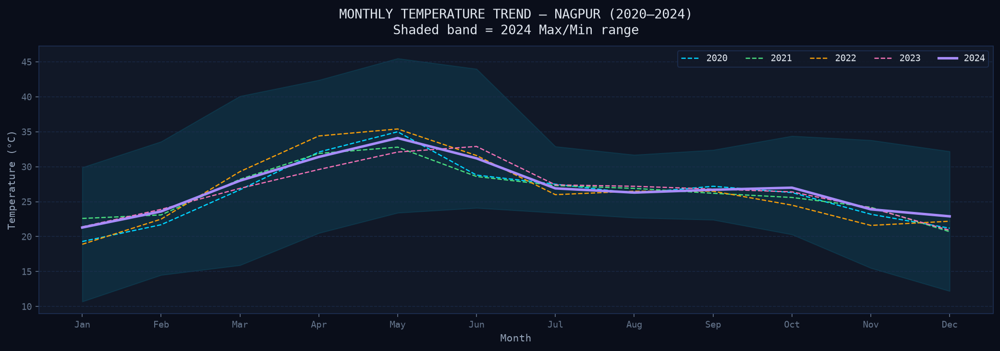
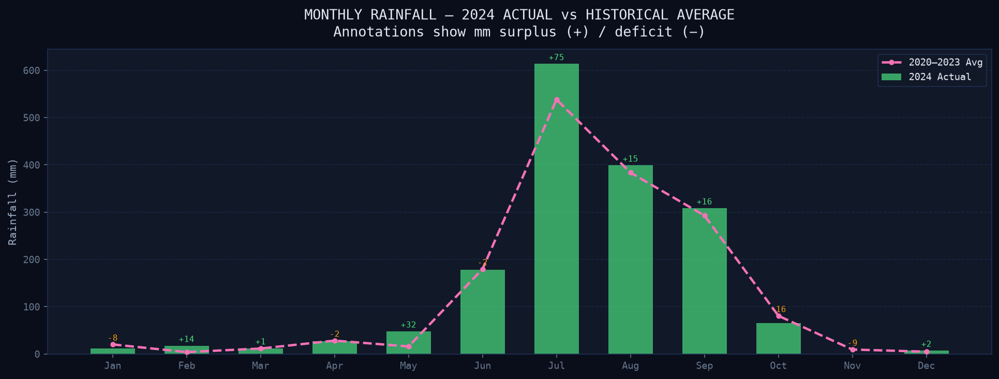
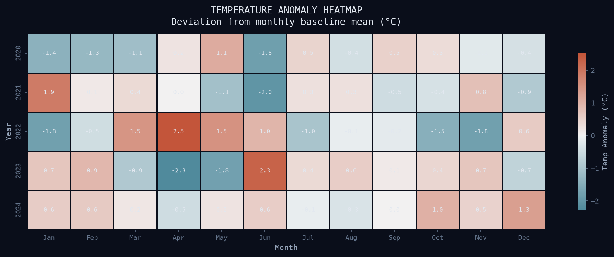
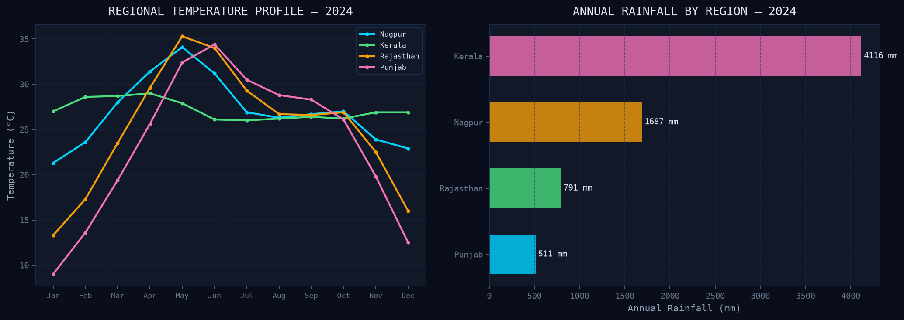
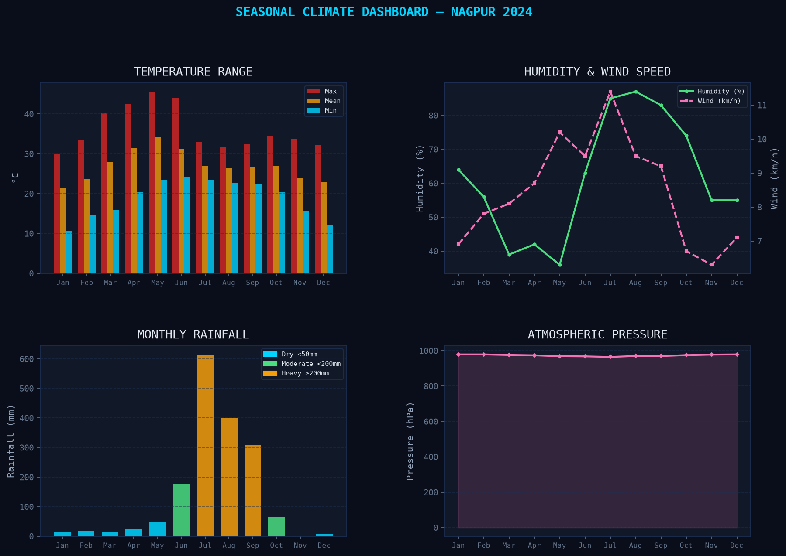
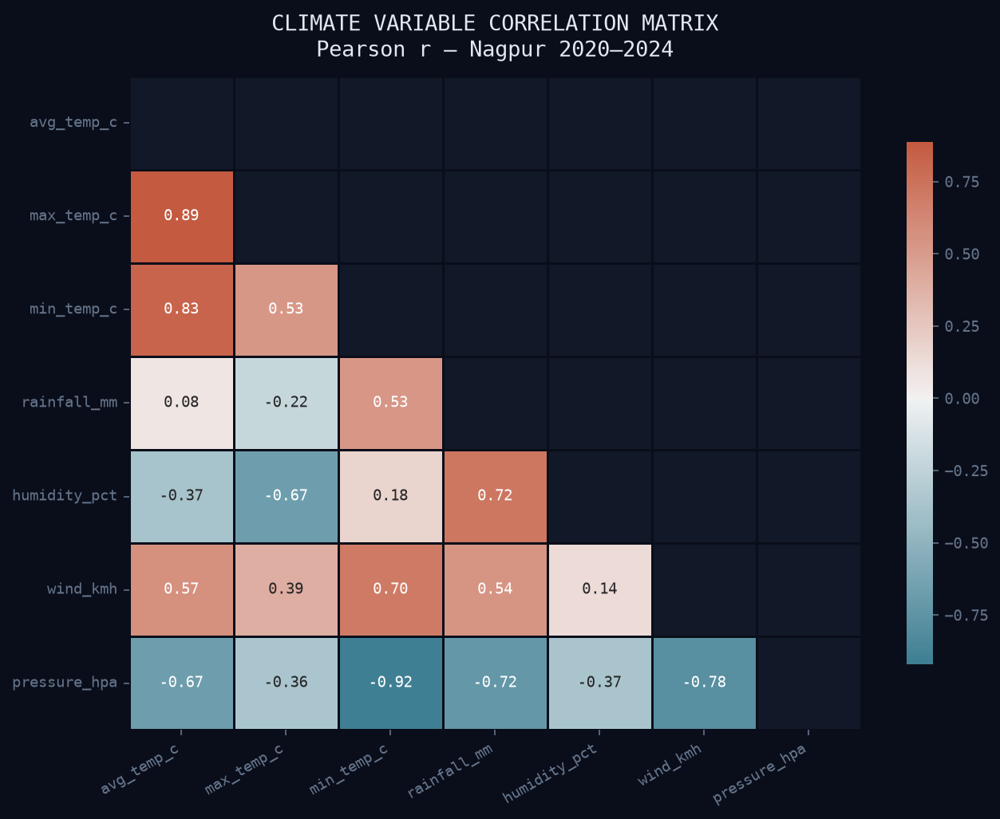
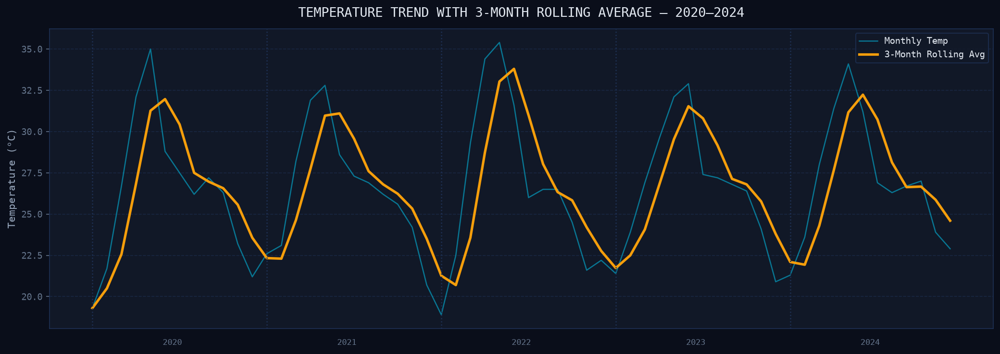

# 🛰️ Climate Data Analysis & Visualization System

> Analyzed multi-year environmental datasets using Python to identify weather trends, seasonal variations, and regional patterns through statistical modeling and graphical dashboards.

---

## 📌 Project Overview

This project is a **satellite-inspired climate data analysis pipeline** built with Python. It processes multi-year meteorological data (Open-Meteo / ERA5 reanalysis) and generates a suite of visualizations covering temperature trends, rainfall patterns, anomaly detection, and region-wise climate comparisons.

**Designed for:** Aerospace / Research / Data Engineering portfolios  
**Domain:** Environmental Data Science | Meteorology | Statistical Modeling

---

## 📊 Charts Preview

### 1. Temperature Trend (2020–2024)


### 2. Rainfall vs Historical Average


### 3. Temperature Anomaly Heatmap


### 4. Regional Comparison


### 5. Seasonal Dashboard


### 6. Correlation Matrix


### 7. Rolling Average Trend


---

## 📁 Project Structure

```
climate-data-analysis-dashboard/
│
├── dataset.csv            ← Multi-region climate dataset (2020–2024)
├── daily_data.csv        ← Daily data (about 7,300 rows) for SQL analysis
├── fetch_data.py          ← Downloads real data from Open-Meteo
├── climate_analysis.py    ← Main analysis & visualization pipeline
├── insights.py            ← Auto-generates insights.md from the data
├── sql_analysis.py        ← Loads data into SQLite and runs queries.sql
├── queries.sql            ← SQL analysis (GROUP BY, RANK, LAG, rolling AVG)
├── app.py                 ← Interactive Streamlit dashboard
├── requirements.txt       ← Python dependencies
├── README.md              ← Project documentation
└── charts/                ← Auto-generated chart outputs (PNG)
    ├── 01_temperature_trend.png
    ├── 02_rainfall_comparison.png
    ├── 03_anomaly_heatmap.png
    ├── 04_regional_comparison.png
    ├── 05_seasonal_dashboard.png
    ├── 06_correlation_matrix.png
    └── 07_rolling_average.png
```

---

## 📈 Charts Generated

| # | Chart | Description |
|---|-------|-------------|
| 1 | Temperature Trend | Year-on-year monthly temp comparison (2020–2024) with max/min shaded band |
| 2 | Rainfall Comparison | 2024 actual rainfall vs. 4-year historical average with deficit/surplus annotation |
| 3 | Anomaly Heatmap | 5×12 grid heatmap of temperature anomalies (deviation from baseline mean) |
| 4 | Regional Comparison | Side-by-side multi-region temp profiles and annual rainfall ranking |
| 5 | Seasonal Dashboard | 4-panel summary: temp range, humidity & wind, rainfall intensity, pressure |
| 6 | Correlation Matrix | Pearson correlation heatmap across all climate variables |
| 7 | Rolling Average | 3-month rolling temperature average across the full 5-year dataset |

---

## 🗃️ Dataset

**File:** `dataset.csv`  
**Records:** 240 monthly rows (4 regions x 5 years x 12 months) in `dataset.csv`, plus 7,308 daily rows in `daily_data.csv` (SQL analysis)  
**Regions:** Nagpur, Kerala, Rajasthan, Punjab  
**Years:** 2020 – 2024  

| Column | Unit | Description |
|--------|------|-------------|
| `year` | — | Calendar year |
| `month` | 1–12 | Month number |
| `month_name` | — | Month abbreviation |
| `region` | — | Indian state/city |
| `avg_temp_c` | °C | Monthly average temperature |
| `max_temp_c` | °C | Monthly maximum temperature |
| `min_temp_c` | °C | Monthly minimum temperature |
| `rainfall_mm` | mm | Total monthly rainfall |
| `humidity_pct` | % | Average relative humidity |
| `wind_kmh` | km/h | Average wind speed |
| `pressure_hpa` | hPa | Average atmospheric pressure |

> **Data source:** Weather data by [Open-Meteo.com](https://open-meteo.com/) (CC BY 4.0), based on ERA5 reanalysis from Copernicus / ECMWF, downloaded with `fetch_data.py`. Each region is represented by one city: Nagpur, Kerala = Kochi, Rajasthan = Jaipur, Punjab = Ludhiana. Values are reanalysis data, not direct station readings.

---

## ⚙️ Setup & Run

### 1. Clone the repository
```bash
git clone https://github.com/KetanDiwate23/climate-data-analysis-dashboard.git
cd climate-data-analysis-dashboard
```

### 2. Install dependencies
```bash
pip install -r requirements.txt
```

### 3. (Optional) Download real data
```bash
python fetch_data.py
```
Pulls 2020–2024 data for Nagpur, Kerala (Kochi), Rajasthan (Jaipur) and Punjab (Ludhiana) from the free Open-Meteo API. It writes monthly data to `dataset.csv` and daily data to `daily_data.csv`.

### 4. Run the analysis
```bash
python climate_analysis.py
```
All 7 charts are saved to `charts/` and the key findings are written to `insights.md`.

### 5. SQL analysis and interactive dashboard
```bash
python sql_analysis.py      # runs queries.sql on the data in SQLite
streamlit run app.py        # opens the interactive dashboard
```

---

## 🔬 Statistical Methods Used

| Technique | Application |
|-----------|-------------|
| **Z-Score Anomaly Detection** | Identifying months with abnormal temperatures vs. baseline |
| **Rolling Mean (3-month window)** | Smoothing short-term fluctuations to reveal long-term trends |
| **Pearson Correlation** | Measuring relationships between climate variables |
| **Grouped Aggregation** | Monthly/annual statistics by region and year |
| **Pivot Tables** | Restructuring data for heatmap visualization |
| **SQL window functions** | RANK, LAG and rolling AVG in `queries.sql` (SQLite) |
| **Linear trend (polyfit)** | Yearly warming/cooling slope in `insights.py` |

---

## 🛠️ Tech Stack

| Tool | Purpose |
|------|---------|
| `Python 3.10+` | Core language |
| `Pandas` | Data loading, cleaning, groupby aggregation |
| `NumPy` | Numerical operations, z-score calculation |
| `Matplotlib` | All chart rendering and layout |
| `Seaborn` | Heatmaps and statistical visualization |
| `SQLite` | SQL analysis with window functions |
| `Streamlit` | Interactive dashboard |
| `Requests` | Fetching data from the Open-Meteo API |

---

## 🔧 Extend This Project

Ideas to expand:
- [x] Real data fetch from [Open-Meteo API](https://open-meteo.com/) (`fetch_data.py`)
- [ ] Add more Indian cities (Mumbai, Chennai, Delhi, Kolkata)
- [ ] Export summary statistics to a PDF report
- [x] Streamlit web dashboard for interactive exploration (`app.py`)
- [ ] Train a simple ML model (Linear Regression / LSTM) to forecast temperature

---

## 📄 License

MIT License — free to use, modify, and distribute.

---

## 👤 Author

**Ketan Diwate**  
B.Tech — Data Science, G.H. Raisoni College of Engineering, Nagpur  
[LinkedIn](https://www.linkedin.com/in/ketan-diwate) · [GitHub](https://github.com/KetanDiwate23)
